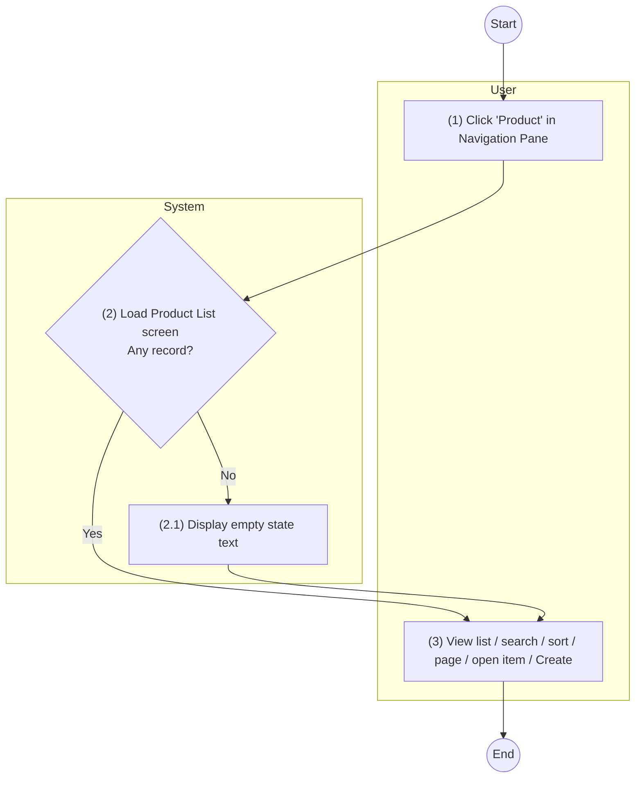

# Example — UC 1: View List of existing Products

Reference output for a View list spec. Numbering starts at 1 (UC 1, BR 1, Screen 1).
The spec refers to UCs it does not contain by name only (UC: Create Product,
UC: View an existing Product).

---

#### UC 1: View List of existing Products

| **Objective:** | This use case allows user to view list of existing Products. |
|---|---|
| **Actor:** | All authenticated users. |
| **Trigger:** | User clicks on "Product" in the left Navigation Pane. |
| **Pre-condition:** | User logged in successfully as actor above. |
| **Post-condition:** | The system displays the list of existing Products. |

**Activity Flows**

| Step | User | System |
|---|---|---|
| (1) | User clicks on "Product" in the left Navigation Pane. | |
| (2) | | The system loads Product List screen with the Product records that satisfy the Data Source conditions, sorted by [Product Code] in descending order. |
| (2.1) | | If no Product record satisfies the conditions, the system displays the empty state text. |
| (3) | User views the list of Products. User may search, sort, change page, click on [Product Code] to open a Product (UC: View an existing Product) or click on "Create" button (UC: Create Product). | |

**Business Rules**

| Step | BR Code | Description |
|---|---|---|
| (2) (2.1) | **BR 1** | <u>**Screen Displaying Rules:**</u> The system will load screen: <<cross reference to Product List screen>>. - The system retrieves data as described in Data Source of the screen: &nbsp;&nbsp;- If {Current Login User} has role "System Admin", display Product records with [Status] is "Active" or "Inactive". &nbsp;&nbsp;- Otherwise, display Product records with [Status] is "Active" only. - The system sorts records by [Product Code] in descending order. - The system displays "Create" button only when {Current Login User} has role "System Admin". - If there is no Product record to display, the table displays the text "No data found." |

---

### Product List Screen

- This screen allows all authenticated users to view list of existing Products.
- User can access this screen by:
  - Step 1: Log in the system.
  - Step 2: Click on module "Product" in Navigation Pane in the left.

*Screen 1: Product List screen*
Mockup: The BA will attach the mockup.

| **Data Source** | Retrieve all "Product" records satisfying: - If {Current Login User} has role "System Admin": [Status] is "Active" or "Inactive". - Otherwise: [Status] is "Active". |
|---|---|
| **Default Sorting** | Sorted by [Product Code] in descending order. |

| # | Component | Component Type | Description |
|---|---|---|---|
| 1 | Create | Button | This button allows System Admin to create a new Product. Display only when {Current Login User} has role "System Admin". Refer to UC: Create Product. |
| 2 | Search Bar | Search Bar | Refer to Search Component. |
| 3 | Product Code | Column Header | Retrieve from [Product Code] of corresponding Product. Link to item: Product Details screen of this Product Code. |
| 4 | Product Name | Column Header | Retrieve from [Product Name] of corresponding Product. |
| 5 | Line of Business | Column Header | Retrieve from [Line of Business Name] of "Line of Business" that has [Line of Business ID] is [Line of Business] of corresponding Product. |
| 6 | Status | Column Header | Retrieve from [Status] of corresponding Product, display as: - "Active" if [Status] is "Active". - "Inactive" if [Status] is "Inactive". |
| 7 | Last Modified At | Column Header | Retrieve from [Last modified at] of corresponding Product. Date time format: Refer to Common field controls. |
| 8 | Pagination | Pagination | Refer to Pagination. |

**Other display rules**
- View columns display: Refer to View Columns Display.
- Pagination: Refer to Pagination.
- Search: Refer to Search Component.
- Bulk Action: N/A – this screen has no bulk action.
- Empty state: If no Product record satisfies the Data Source conditions or the search keyword, the table displays the text "No data found."

---

#### New Messages
None.

#### Open Questions
None.
