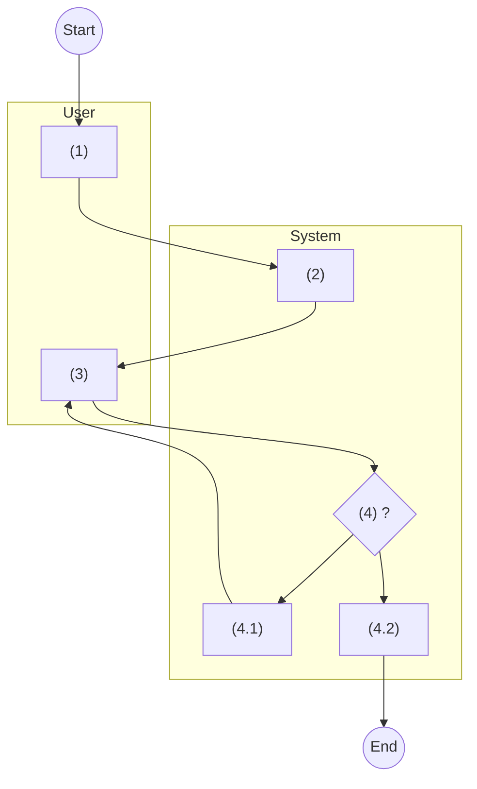

# Use Case Template

Mirrors SRS section 3.3 "Common Use Cases" (CMUC 1–5) and Product UC 4–8.
Replace every `<...>`. Delete the guidance lines (starting with `>`) in the output.

---

#### UC <n>: <Verb phrase> <Object>

> Title patterns used in the SRS: "Create Product", "Edit Product",
> "View an existing Product", "View List of existing Products", "Disable an existing Product",
> "Delete an existing <Object>".

| **Objective:** | This use case allows user to <action> <Object>. |
|---|---|
| **Actor:** | <Role 1>, <Role 2>. |
| **Trigger:** | User clicks on "<Button>" on <<cross reference to <Screen Name> screen>>. |
| **Pre-condition:** | User logged in successfully as actor above. [<Field>] of the <Object> is "<Value>". |
| **Post-condition:** | <Result in active voice, e.g. "The system creates a new Product.">. |

> - Trigger for a menu entry: `User clicks on "<Menu Item>" in the left Navigation Pane.`
> - Trigger for opening an item: `User selects to open an existing <Object> on <<cross reference to <Object> List screen>>.`
> - Add status pre-conditions as extra lines (one condition per line). Omit if none.

**Activity Flows**

| Step | User | System |
|---|---|---|
| (1) | <User action>. | |
| (2) | | <System action>. |
| (3) | <User action>. | |
| (4) | | <System action>. |
| (4.1) | | <Sub-step: e.g. validation fails → display IEM 1, return to (3)>. |
| (4.2) | | <Sub-step: e.g. validation passes → create record>. |

> - One action per row, in exactly one lane.
> - Sub-steps (n.1), (n.2) are alternatives/branches of step (n); each branch says where the
>   flow goes next ("return to (3)", "end").
> - The Step numbers are the ones cited in the Business Rules "Step" column.

> Keep node labels identical to the table text (shortened is fine) so the Word swimlane can
> be redrawn from either.

**Business Rules**

| Step | BR Code | Description |
|---|---|---|
| (2) | **BR <n>** | <u>**Screen Displaying Rules:**</u> The system will load screen: <<cross reference to <Screen Name> screen>>. |
| (4) (4.1) | **BR <n+1>** | <u>**Validating Rules:**</u> After user clicks on "Save" button, the system will validate all the mandatory fields as stated in screen description. - If user leaves any mandatory field blank, the system displays inline error message IEM 1 Please input in this field. under the corresponding field. - Otherwise, go to step (4.2). |
| (4.2) | **BR <n+2>** | <u>**<Creating/Updating/Deleting/Disabling> Rules:**</u> After passing the validation rules, the system will … - … - Save all changes. - Refer to CBR1 to log basic audit trail. - The system will load screen: <<cross reference to <Screen Name> screen>>. |

> - Description always starts with the underlined bold rule type, then a line break.
> - Allowed rule types (see srs-conventions.md §5): Screen Displaying Rules, Validating Rules,
>   Creating Rules, Updating Rules, Confirmation Rules, Deleting Rules, Disabling Rules,
>   plus object-specific ones (e.g. Submitting Rules, Accepting Rules).
> - Use ` ` for line breaks and `- ` for bullet lines inside a cell.
> - Messages are always cited as code + text: `IEM 1 Please input in this field.`
> - Branches point to BRs or steps: `If User clicks on "No", go to BR <n>.`

---

#### New Messages
> Only if the UC introduced message codes not in the SRS appendix.

| Type | Code | Message |
|---|---|---|
| Success Dialog | SCD <n> | <Message>. |

#### Open Questions
1. `[TBC]` <Item> — assumed "<value>". <Question to confirm>?
