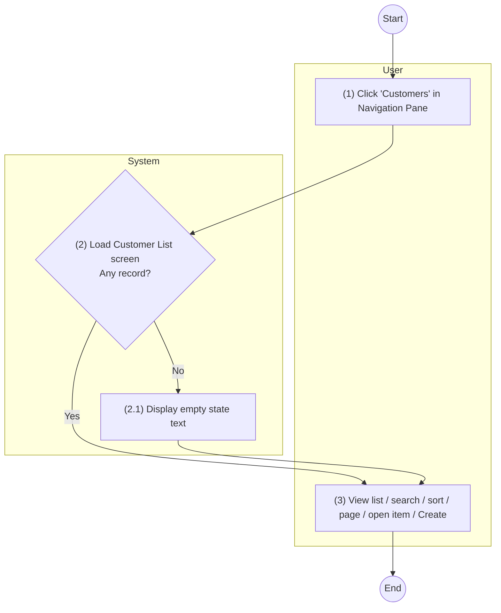

#### UC 1: View List of existing Customers

| **Objective:** | This use case allows user to view list of existing Customers. |
|---|---|
| **Actor:** | System Admin, Sales. |
| **Trigger:** | User clicks on "Customers" in the left Navigation Pane. [TBC] |
| **Pre-condition:** | User logged in successfully as actor above. |
| **Post-condition:** | The list of existing Customers is displayed. |

**Activity Flows**

| Step | User | System |
|---|---|---|
| (1) | User clicks on "Customers" in the left Navigation Pane. | |
| (2) | | The system loads Customer List screen with the Customer records that satisfy the Data Source conditions, sorted by [Customer ID] in descending order. |
| (2.1) | | If no Customer record satisfies the conditions, the system displays the empty state text. |
| (3) | User views the list of Customers. User may search, sort, change page, click on [Customer ID] to open a Customer (UC: View an existing Customer) or click on "Create" button (UC: Create Customer). | |

**Business Rules**

| Step | BR Code | Description |
|---|---|---|
| (2) (2.1) | **BR 1** | <u>**Screen Displaying Rules:**</u> The system will load screen: <<cross reference to Customer List screen>>. - Data is retrieved as described in Data Source of the screen. - Records are sorted by [Customer ID] in descending order. - "Create" button is displayed only for the actors of UC: Create Customer. - If there is no Customer record to display, the table displays the text "No data found." |

---

### Customer List Screen

- This screen allows System Admin and Sales to view list of existing Customers.
- System Admin and Sales can access this screen by:
  - Step 1: Log in the system.
  - Step 2: Click on module "Customers" in Navigation Pane in the left.

*Screen 1: Customer List screen*
Mockup: to be attached.

| **Data Source** | Retrieve all "Customer" records. |
|---|---|
| **Default Sorting** | Sorted by [Customer ID] in descending order. |

| # | Component | Component Type | Description |
|---|---|---|---|
| 1 | Create | Button | This button allows user to create a new Customer. Display only for the actors of UC: Create Customer. Refer to UC: Create Customer. |
| 2 | Search Bar | Search Bar | Refer to Search Component. |
| 3 | Customer ID | Column Header | Retrieve from [Customer ID] of corresponding Customer. Link to item: Customer Details screen of this Customer ID. |
| 4 | Customer Name | Column Header | Retrieve from [Customer Name] of corresponding Customer. |
| 5 | Phone Number | Column Header | Retrieve from [Phone Number] of corresponding Customer. |
| 6 | Email | Column Header | Retrieve from [Email] of corresponding Customer. |
| 7 | Customer Type | Column Header | Retrieve from [Customer Type] of corresponding Customer. |
| 8 | Status | Column Header | Retrieve from [Status] of corresponding Customer. |
| 9 | Last Modified At | Column Header | Retrieve from [Last modified at] of corresponding Customer. Date time format: Refer to Common field controls. |
| 10 | Pagination | Pagination | Refer to Pagination. |

**Other display rules**
- View columns display: Refer to View Columns Display.
- Pagination: Refer to Pagination.
- Search: Refer to Search Component.
- Bulk Action: N/A – this screen has no bulk action.
- Empty state: If no Customer record satisfies the Data Source conditions or the search keyword, the table displays the text "No data found."

---

#### New Messages
None.

#### Open Questions
1. `[TBC]` Menu item that opens this list — assumed "Customers" in the left Navigation Pane. What is it called in the app?
